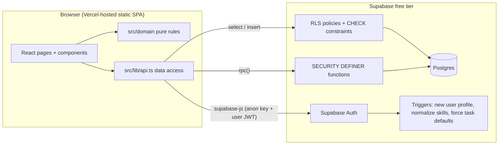
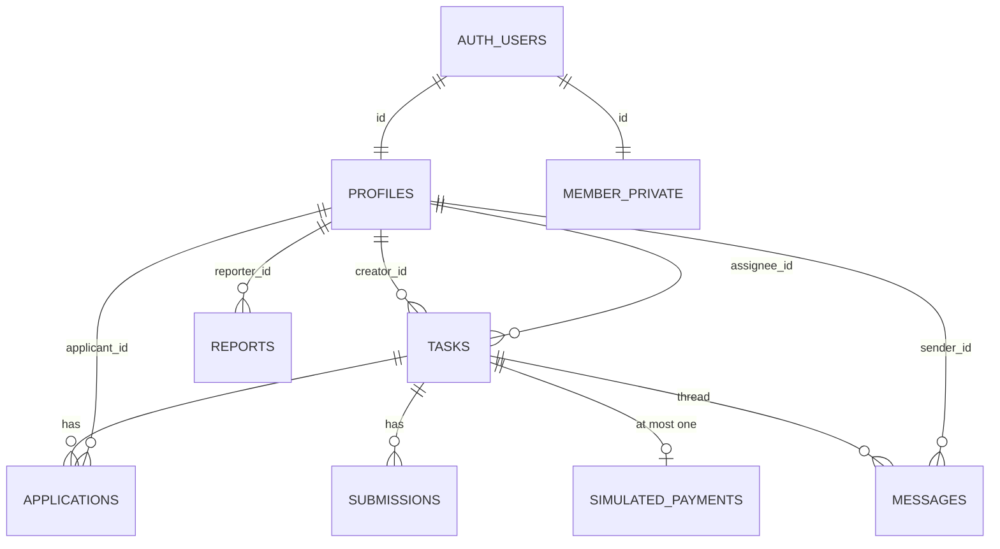
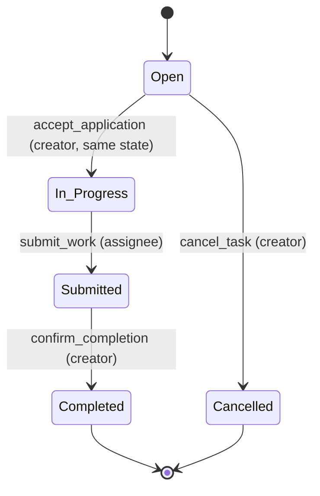
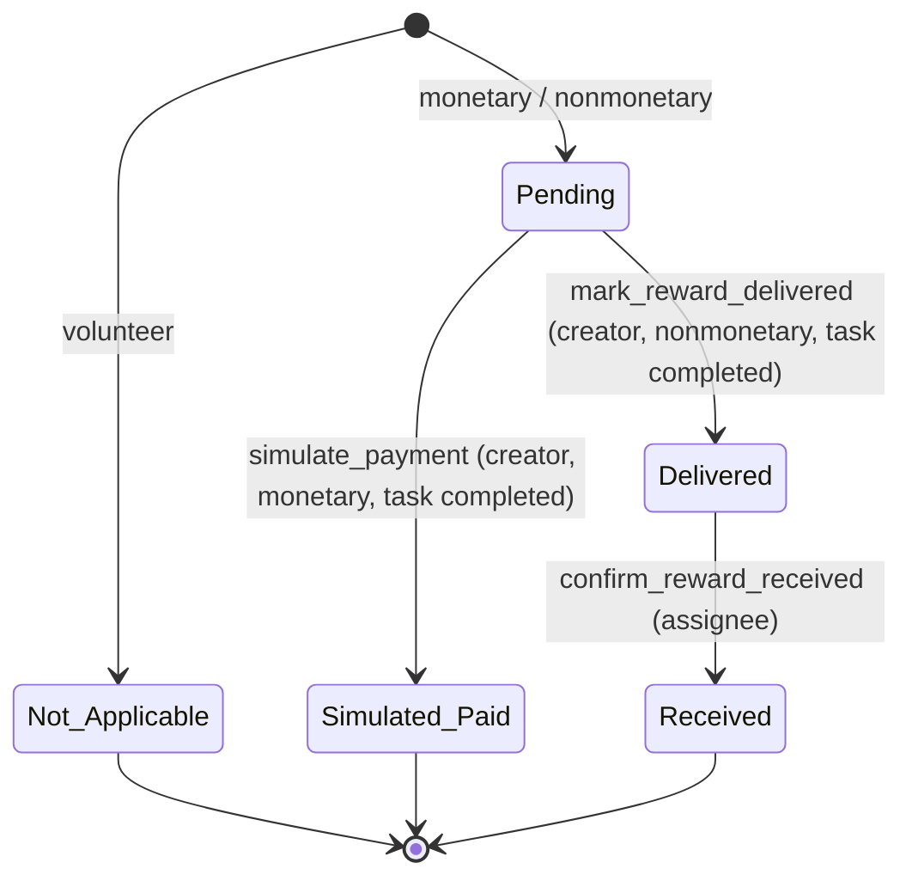

# Design Document: Bounty Platform

## Overview

Bounty is a single-page web app (React) that talks directly to a hosted Supabase project (Postgres + Auth). There is no custom server. All business rules that must be trusted (who can do what, the Task and Reward state machines, the same-state rule, validation) live in the database as constraints, Row Level Security (RLS) policies, and Postgres functions. The same rules are mirrored in a small pure TypeScript "domain" module so the UI can validate instantly and so the rules can be property-tested without a network.

Design goals, in order: ship the core loop by the deadline, keep it reliable under direct API calls, keep it simple enough for one beginner developer.

Key decisions and why:

| Decision | Rationale |
|---|---|
| Vite + React + TypeScript + Tailwind + React Router | Fast dev server, zero config deploy on Vercel, types catch mistakes early. |
| Supabase (anon key only in browser) | Free Postgres + Auth; RLS lets the browser talk to the DB safely. |
| Every status change is a Postgres function (RPC) | One call = one transaction. `SELECT ... FOR UPDATE` locks the Task row so two clicks at the same time cannot both succeed (Req 6.6, 8.10). Rules can't be bypassed with the anon key (Req 8.8). |
| No UPDATE policy on `tasks`, `applications`, `simulated_payments` | The only way to change status is through the RPCs. Fewer policies = fewer holes. |
| Money stored as integer cents | No floating-point rounding; makes the Reward round-trip exact (Req 3.10). |
| Text + CHECK constraints instead of Postgres enums | Easier to read and change during a hackathon. |
| Age_Bracket in a separate `member_private` table | Public `profiles` reads can never leak it (Req 1.14, 10.9). |
| SQL files run in the Supabase SQL editor | No Supabase CLI or Docker needed on Windows. |
| Messages load on page load/refresh only | Realtime is out of scope (Confirmed Decision 7). |

Beginner note: "RLS" means Postgres itself checks every row read or written against a rule such as "only the owner can update this profile". Because the check runs in the database, it works even if someone skips the website and calls the API directly.

References: [Supabase RLS](https://supabase.com/docs/guides/database/postgres/row-level-security), [Supabase database functions](https://supabase.com/docs/guides/database/functions), [Managing user data with triggers](https://supabase.com/docs/guides/auth/managing-user-data), [Vercel SPA rewrites](https://vercel.com/docs/projects/project-configuration#rewrites), [fast-check](https://fast-check.dev/), [Vitest](https://vitest.dev/).

## Architecture



Request paths:

- Reads (browse, task detail, profile, dashboard): `supabase.from(...).select(...)`, filtered by RLS.
- Simple creates (task, profile edit, message, report): `insert`/`update` guarded by RLS `WITH CHECK`, CHECK constraints, and triggers.
- All state changes: `supabase.rpc('fn_name', args)`. Each function locks the Task row, checks `auth.uid()`, the current status, and the rule, then writes everything or raises an error.

Error codes: RPCs and triggers `raise exception` with a short code (for example `NOT_SAME_STATE`). `src/lib/errors.ts` maps codes to plain-language messages so raw DB text never reaches the UI (Req 16.9).

### Route Map

| Path | Page | Access |
|---|---|---|
| `/` | Landing | Public |
| `/signup` | Sign up | Public |
| `/signin` | Sign in | Public |
| `/browse` | Browse local tasks | Public (Visitors pick a state) |
| `/tasks/new` | New task form | Member (else redirect `/signin`) |
| `/tasks/:id` | Task detail: info, apply, applicants, submission, settlement, messages, report | Public view; actions by role |
| `/dashboard` | Posted / Working On / Applications | Member |
| `/profile/edit` | Edit own profile | Member |
| `/profile/:id` | Public profile + completed projects | Public |
| `*` | Not found | Public |

`vercel.json`:

```json
{ "rewrites": [{ "source": "/(.*)", "destination": "/index.html" }] }
```

### Project Structure

```
/
├─ .kiro/                  specs, steering, hooks (Req 11.6)
├─ docs/kiro-log.md        evidence log for judges
├─ supabase/
│  ├─ schema.sql           tables, constraints, RLS, functions, triggers
│  └─ seed.sql             idempotent demo seed
├─ src/
│  ├─ domain/              pure rules (no network, no Date.now)
│  │  ├─ constants.ts      US_STATES, CATEGORIES, statuses, limits
│  │  ├─ reward.ts         validateReward, toRow, fromRow, formatReward
│  │  ├─ validation.ts     validateSignUp, validateProfile, validateTask, validateSubmission, validateCover, validateMessage, validateReport, normalizeSkills
│  │  ├─ taskMachine.ts    TaskModel + reduce(model, request)
│  │  ├─ rewardMachine.ts  rewardTransition(...)
│  │  ├─ browse.ts         filterTasks
│  │  ├─ nextAction.ts     nextActionLabel
│  │  └─ labels.ts         humanize (In_Progress -> "In progress")
│  ├─ lib/                 supabase.ts, api.ts, errors.ts, withTimeout.ts, auth context
│  ├─ components/          shared UI (see below)
│  ├─ pages/               one file per route
│  └─ main.tsx, App.tsx
├─ tests/domain/*.test.ts  Vitest + fast-check
├─ vercel.json, .env.example, tailwind.config.ts, README.md
```

## Components and Interfaces

### Shared Design System

All tokens come from `tailwind.config.ts` (Req 17.2). Suggested tokens: `brand` (indigo-700 on white, 4.5:1+), `ink` (slate-900), `muted` (slate-600), `surface` (white/slate-50), `danger` (red-700), `success` (green-700), a single font stack, and the default spacing scale. Focus ring: `focus-visible:ring-2 ring-offset-2 ring-brand` everywhere (Req 16.2).

| Component | Purpose / accessibility notes |
|---|---|
| `Layout` | Renders exactly one `<header>`, `<nav>`, `<main>`, `<footer>` (Req 16.5). Nav shows Member links only when signed in. |
| `Button` | Variants `primary`, `secondary`, `danger`; `loading` prop disables it (Req 2.10). Icon-only buttons require `aria-label`. |
| `Field` (Input / Textarea / Select) | Visible `<label htmlFor>`, error text linked via `aria-describedby`, `aria-invalid` (Req 16.3, 16.6). |
| `Form` helper | On failed validation, focuses the first invalid field (Req 16.6). |
| `Card` | Task cards in browse and dashboard. |
| `Badge` | Text label + icon for Task_Status, Reward_Type, Reward_Status, Application_Status; text always visible (Req 16.8). Uses `humanize`. |
| `RewardDisplay` | Uses `formatReward` (label, icon, `$150.00`, kind + description) (Req 3.9). |
| `Toast` | `role="status"` `aria-live="polite"`, stays 6 s or until dismissed (Req 17.6). |
| `Loading` | Spinner + visible text "Loading" (Req 17.3). |
| `ErrorState` | Plain message naming the failed action + "Retry" button (Req 17.4, 17.5). Form-level backend errors use `role="alert"` region without moving focus (Req 16.7). |
| `YouthSafetyNotice` | Shared notice text (Req 1.3, 13.4). |
| `DemoNotice` | "Demo only - no real money is moved" (Req 9.5). |
| `ReportButton` / `ReportDialog` | Reason select + optional note (Req 15). |
| `RequireAuth` | Route wrapper; redirects Visitors to `/signin` (Req 1.17, 2.6, 14.7). |
| `SafeLink` | Renders `<a>` only if `isHttpUrl(url)`, else plain text (Req 10.4). |

All user text is rendered through normal JSX (`{text}`), which React escapes. `dangerouslySetInnerHTML` is banned (Req 10.3).

### Domain Module Interfaces (TypeScript)

```ts
type Result<T> = { ok: true; value: T } | { ok: false; errors: Record<string, string> };

// reward.ts
type Reward =
  | { type: 'monetary'; amountCents: number }
  | { type: 'nonmonetary'; kind: 'product'|'service'|'experience'|'other'; description: string; estimatedValueCents: number | null }
  | { type: 'volunteer' };
function validateReward(input: RewardFormInput): Result<Reward>;
function toRow(r: Reward): RewardRow;          // DB columns
function fromRow(row: RewardRow): Reward;
function formatReward(r: Reward): { label: string; icon: string; detail: string };
function parseDollars(s: string): number | null; // "150.5" -> 15050, rejects >2 decimals

// validation.ts
function normalizeSkills(skills: string[]): string[]; // trim, drop dup (case-insensitive), keep first
function validateTask(input: TaskFormInput, today: string /* YYYY-MM-DD */): Result<NewTask>;
function validateSignUp(input: SignUpInput): Result<SignUp>;
function validateProfile(input: ProfileInput): Result<ProfileUpdate>;
function validateSubmission(input: { description: string; urls: string[] }): Result<NewSubmission>;
function isHttpUrl(s: string): boolean;

// location / same state
function sameState(taskState: UsState, profileState: UsState): boolean;

// taskMachine.ts  (in-memory model of one Task used by tests and UI enablement)
interface TaskModel {
  creatorId: string; usState: UsState; status: TaskStatus; assigneeId: string | null;
  rewardType: RewardType; rewardStatus: RewardStatus; amountCents: number | null;
  applications: { id: string; applicantId: string; status: AppStatus }[];
  payments: { amountCents: number }[];
  profiles: Record<string, { usState: UsState }>;
}
type Request =
  | { kind: 'apply'; actor: string } | { kind: 'accept'; actor: string; applicationId: string }
  | { kind: 'submit'; actor: string } | { kind: 'confirm'; actor: string }
  | { kind: 'cancel'; actor: string } | { kind: 'pay'; actor: string }
  | { kind: 'markDelivered'; actor: string } | { kind: 'confirmReceived'; actor: string };
function reduce(m: TaskModel, r: Request): { ok: true; model: TaskModel } | { ok: false; code: ErrorCode; model: TaskModel };

// rewardMachine.ts
function rewardTransition(t: { rewardType; rewardStatus; taskStatus; creatorId; assigneeId },
  action: 'pay'|'markDelivered'|'confirmReceived', actor: string): Result<RewardStatus>;

// browse.ts
interface BrowseFilters { usState: UsState | null; town?: string; category?: Category; rewardType?: RewardType; keyword?: string }
function filterTasks(tasks: TaskSummary[], f: BrowseFilters): TaskSummary[]; // open only, AND, sorted newest first

// nextAction.ts
type NextAction = 'Review applicants'|'Confirm completion'|'Settle reward'|'Submit work'|'Confirm reward received'|'No action needed';
function nextActionLabel(t: DashboardTask, memberId: string, list: 'posted'|'working'): NextAction;
```

### Database Functions (RPC)

All are `security definer`, `set search_path = public`, start with `if auth.uid() is null then raise exception 'NOT_SIGNED_IN'`, and lock the Task with `select ... from tasks where id = p_task for update`.

| Function | Checks | Writes | Req |
|---|---|---|---|
| `apply_to_task(p_task uuid, p_cover text)` | task open, not creator, same state as caller profile, cover 20-1000 trimmed, no active app | insert application `pending` | 5 |
| `accept_application(p_app uuid)` | caller is creator, task open, app pending, applicant profile state = task state | app → accepted, other pending → rejected, task → in_progress, assignee set | 6, 8 |
| `cancel_task(p_task uuid)` | creator, task open | task → cancelled, pending apps → rejected | 8.5 |
| `submit_work(p_task uuid, p_desc text, p_urls text[])` | caller is assignee, task in_progress, valid desc/urls | insert submission, task → submitted | 7 |
| `confirm_completion(p_task uuid)` | creator, task submitted | task → completed, `completed_at = now()` | 7.3 |
| `simulate_payment(p_task uuid)` | creator, completed, monetary, reward pending | insert simulated_payment (amount from task), reward → simulated_paid | 9.3, 9.7 |
| `mark_reward_delivered(p_task uuid)` | creator, completed, nonmonetary, pending | reward → delivered | 9.9 |
| `confirm_reward_received(p_task uuid)` | assignee, completed, nonmonetary, delivered | reward → received | 9.11 |
| `task_has_youth(p_task uuid) returns boolean` | caller is creator or assignee | none (reads `member_private`) | 13.4, 10.9 |

Illustrative shape:

```sql
create or replace function accept_application(p_app uuid) returns void
language plpgsql security definer set search_path = public as $$
declare a applications; t tasks; applicant_state text;
begin
  if auth.uid() is null then raise exception 'NOT_SIGNED_IN'; end if;
  select * into a from applications where id = p_app;
  if not found then raise exception 'NOT_FOUND'; end if;
  select * into t from tasks where id = a.task_id for update;      -- row lock
  if t.creator_id <> auth.uid() then raise exception 'NOT_PERMITTED'; end if;
  if t.status <> 'open' or a.status <> 'pending' then raise exception 'CANNOT_ACCEPT'; end if;
  select us_state into applicant_state from profiles where id = a.applicant_id;
  if applicant_state <> t.us_state then raise exception 'NOT_SAME_STATE'; end if;
  update applications set status = 'rejected' where task_id = t.id and status = 'pending' and id <> a.id;
  update applications set status = 'accepted' where id = a.id;
  update tasks set status = 'in_progress', assignee_id = a.applicant_id where id = t.id;
end $$;
revoke all on function accept_application(uuid) from public, anon;
grant execute on function accept_application(uuid) to authenticated;
```

A Postgres function runs as one transaction, so any raised exception rolls back every write in it (Req 8.9).

### Auth and Sign-up Flow

1. `SignUpPage` validates with `validateSignUp`. The age selector offers Under 13 / 13-17 / 18+; "Under 13" disables submit and shows the minimum-age message (Req 1.2). 13-17 shows `YouthSafetyNotice` above submit (Req 1.3).
2. `supabase.auth.signUp({ email, password, options: { data: { display_name, age_bracket, us_state, town } } })`.
3. Trigger `on_auth_user_created` (security definer) validates metadata and inserts into `profiles` and `member_private`. Invalid metadata raises, so the whole sign-up fails and no account exists (Req 1.5, 1.9).
4. Supabase returns an error for an already-registered email (case-insensitive); mapped to "email already in use" (Req 1.4). Sign-in errors always show one message (Req 1.7).
5. Email confirmation is turned off in Supabase Auth settings so sign-up returns a session immediately.

## Data Models



### Tables

`profiles` (public read)

| Column | Type | Rule |
|---|---|---|
| id | uuid PK, FK auth.users | |
| display_name | text | `char_length(btrim(x)) between 1 and 50` |
| bio | text default '' | ≤ 500 |
| skills | text[] default '{}' | ≤ 20 items, each 1-40 (checked by immutable helper `valid_skills(text[], max int)`); normalized by trigger |
| us_state | text | in 51-value list (`us_state_valid(text)`) |
| town | text | trimmed 2-60 |
| created_at | timestamptz default now() | |

No email, no age, no street address (Req 1.14, 1.15).

`member_private` (owner read only): `id uuid PK FK`, `age_bracket text check in ('13-17','18+')`. No update grant (Req 1.10).

`tasks` (public read)

| Column | Type | Rule |
|---|---|---|
| id | uuid PK default gen_random_uuid() | |
| creator_id | uuid FK profiles | forced to `auth.uid()` by trigger |
| title | text | trimmed 5-100 |
| description | text | trimmed 20-3000 |
| category | text | in Website, Spreadsheet, Graphic_Design, Programming, Writing, Social_Media, Other (stored lowercase snake) |
| skills | text[] | ≤ 10, each 1-40, normalized |
| reward_type | text | monetary / nonmonetary / volunteer |
| amount_cents | int null | 1..1,000,000 |
| nonmonetary_kind | text null | product / service / experience / other |
| reward_description | text null | trimmed 5-300 |
| estimated_value_cents | int null | 0..1,000,000 |
| deadline | date null | "today or later" checked in UI and in trigger against `current_date` (UTC, so allow 1 day of slack) |
| us_state, town | text | as profiles |
| status | text default 'open' | open / in_progress / submitted / completed / cancelled |
| reward_status | text | not_applicable / pending / simulated_paid / delivered / received |
| assignee_id | uuid null FK profiles | |
| completed_at | timestamptz null | |
| created_at | timestamptz default now() | |

Table-level CHECKs:

```sql
check (
  (reward_type = 'monetary'    and amount_cents is not null and nonmonetary_kind is null and reward_description is null and estimated_value_cents is null)
  or (reward_type = 'nonmonetary' and amount_cents is null and nonmonetary_kind is not null and reward_description is not null)
  or (reward_type = 'volunteer'   and amount_cents is null and nonmonetary_kind is null and reward_description is null and estimated_value_cents is null)
),
check ((status in ('open','cancelled')) = (assignee_id is null)),          -- Req 8.7
check ((status = 'completed') = (completed_at is not null)),
check (reward_status = case when reward_type='volunteer' then 'not_applicable' else reward_status end),
check (reward_status in ('not_applicable','pending') or status = 'completed')
```

Trigger `tasks_before_insert`: when `auth.uid()` is not null, sets `creator_id = auth.uid()`, `status = 'open'`, `assignee_id = null`, `completed_at = null`, `reward_status` from reward_type (Req 2.7, 9.1); normalizes skills; trims text. The seed (run as `postgres`, `auth.uid()` null) can insert any valid state.

`applications` (read: applicant or task creator)

| Column | Type | Rule |
|---|---|---|
| id | uuid PK | |
| task_id | uuid FK tasks | |
| applicant_id | uuid FK profiles | |
| cover_message | text | trimmed 20-1000 |
| status | text default 'pending' | pending / accepted / rejected / withdrawn |
| created_at | timestamptz | |

```sql
create unique index one_active_app on applications(task_id, applicant_id)
  where status in ('pending','accepted');                 -- Req 5.5
create unique index one_accepted_app on applications(task_id)
  where status = 'accepted';                              -- Req 6.6
```

`submissions` (read: task participants, or anyone when task completed for Profile project links): `id`, `task_id`, `assignee_id`, `description` trimmed 10-2000, `urls text[]` with `valid_urls(urls)` (1-5 items, each ≤ 2048, `^https?://[^/\s?#]+`), `created_at`.

`simulated_payments` (read: task creator or assignee): `id`, `task_id uuid unique` (Req 9.6), `amount_cents int`, `status text default 'simulated_paid' check (status='simulated_paid')`, `created_at`. No card or bank columns (Req 9.4).

`messages` (read/insert: task creator or assignee while task status in in_progress/submitted/completed): `id bigint generated always as identity` (stable tie-break order), `task_id`, `sender_id` (with check `= auth.uid()`), `body` trimmed 1-2000, `created_at default now()`. No update/delete policies (Req 13.8).

`reports` (read: own only): `id`, `reporter_id` (= auth.uid()), `target_type text in ('task','profile')`, `target_id uuid`, `reason text in ('spam','inappropriate','scam','other')`, `note text default '' ≤ 500`, `created_at`, `unique (reporter_id, target_type, target_id)` (Req 15.3). Insert policy verifies the target exists.

### RLS Summary

| Table | select | insert | update | delete |
|---|---|---|---|---|
| profiles | everyone | none (trigger only) | owner (column grant: display_name, bio, skills, us_state, town) | none |
| member_private | owner | none | none | none |
| tasks | everyone | authenticated (trigger forces owner/status) | none (RPC only) | none |
| applications | applicant or task creator | none (RPC only) | none | none |
| submissions | participants, or anyone if task completed | none (RPC only) | none | none |
| simulated_payments | creator or assignee | none (RPC only) | none | none |
| messages | participants, task active-or-completed | participant, sender = self, task status allowed | none | none |
| reports | reporter | authenticated, reporter = self | none | none |

`alter table ... enable row level security` on all eight tables; with no matching policy Postgres denies by default (Req 10.1). Grants: `revoke update on tasks, applications ... from anon, authenticated`.

### Domain Enum Mapping

The UI maps snake_case DB values to display words with `humanize` (`in_progress` → "In progress", `graphic_design` → "Graphic design") (Req 16.9).

### Status State Machines





### Demo Seed (`supabase/seed.sql`)

- Fixed UUIDs for every demo row (for example `00000000-0000-0000-0000-00000000000a`).
- Demo auth users inserted into `auth.users` with `crypt('DemoPass123!', gen_salt('bf'))`, `email_confirmed_at = now()`, `aud = 'authenticated'`, `role = 'authenticated'`, empty-string token columns, plus a matching row in `auth.identities` (GoTrue needs it for password sign-in). `on conflict (id) do nothing`.
- The new-user trigger creates profiles; the seed then upserts profiles, tasks, applications, submissions, and payments with `on conflict (id) do update set ...` so re-running restores the exact seeded values without duplicates (Req 11.4).
- Data: 3+ Massachusetts members (business owner 18+, college student 18+, youth 13-17), 6+ MA tasks across all Reward_Types and 3+ Categories, every Task_Status represented, one open task with a pending application, one completed monetary task with its simulated payment, and one open New Hampshire task to demo the same-state rejection (Req 11.1-11.3, 11.9).
- If the direct `auth.users` insert fails on the hosted project, fallback: create the 3 users in the Supabase dashboard (Authentication > Add user) with the fixed emails, then run the rest of the seed, which looks members up by email.

## Correctness Properties

*A property is a characteristic or behavior that should hold true across all valid executions of a system-essentially, a formal statement about what the system should do. Properties serve as the bridge between human-readable specifications and machine-verifiable correctness guarantees.*

All properties run against `src/domain` pure functions. The invariant properties (9, 10, 11, 12, 13, 14, 15 below; Req 5.5, 6.4, 6.6, 8.6, 9.6, 9.13) generate a random starting `TaskModel` (2-5 Members, random states) and a random sequence of 1-20 `Request`s from random actors, fold them through `reduce`, and check the invariant after every step (Req 12.3).

Reflection notes: per-field validation criteria (3.1-3.8, 2.1-2.4, 1.1/1.5/1.10/1.11, 7.1/7.2/7.7, 10.4) were merged into one validator property per form instead of one per field. Single-transition criteria (5.1, 6.2, 6.5, 7.3, 8.5, 9.3, 9.9, 9.11) are subsumed by the state-machine and invariant properties, plus one example test each. All "rejected request leaves state unchanged" criteria are merged into Property 11.

### Property 1: Reward round trip

For any valid Reward `r`, `fromRow(toRow(r))` is deeply equal to `r` (same type, same cents, same kind, same trimmed description, same estimated value or `null`).

**Validates: Requirements 3.10**

### Property 2: Reward validation accepts exactly well-formed Rewards

For any Reward form input (generated from valid values plus mutations: missing type, extra foreign fields, out-of-range or >2-decimal amounts, non-numeric strings, short/long descriptions, bad kinds), `validateReward` returns `ok` if and only if the input satisfies every rule of Requirement 3.1-3.8, and on failure every invalid field appears as a key in `errors`.

**Validates: Requirements 3.1, 3.2, 3.3, 3.4, 3.5, 3.6, 3.7, 3.8**

### Property 3: Reward display contains required information

For any valid Reward, `formatReward` returns the label matching its type, an icon unique to that type, and for Monetary a string matching `^\$[\d,]+\.\d{2}$` equal to the cents value; for Nonmonetary the output contains the humanized kind and the description.

**Validates: Requirements 3.9**

### Property 4: Skill normalization

For any list of strings, `normalizeSkills` returns a list with no two entries equal case-insensitively after trimming, each entry is the trimmed first occurrence of its group in original order, and `normalizeSkills(normalizeSkills(x))` equals `normalizeSkills(x)` (idempotence).

**Validates: Requirements 1.12, 2.8**

### Property 5: Task form validation

For any task form input and any `today` date, `validateTask` returns `ok` if and only if title is 5-100 and description 20-3000 after trim, exactly one valid Category, 0-10 Skills each 1-40, valid Reward, deadline absent or `>= today`, valid US_State, and Town 2-60; otherwise `errors` names every failing field.

**Validates: Requirements 2.1, 2.3, 2.4**

### Property 6: Sign-up and profile validation

For any sign-up or profile form input, `validateSignUp` / `validateProfile` return `ok` if and only if every field meets the rules of Requirements 1.1 and 1.10 (email shape and ≤254, password 8-72, display name 1-50 trimmed, Age_Bracket in 13-17/18+, valid US_State, Town 2-60, bio ≤500, ≤20 Skills each 1-40); otherwise `errors` names every failing field and no valid field.

**Validates: Requirements 1.1, 1.5, 1.10, 1.11**

### Property 7: Submission and URL validation

For any submission input, `validateSubmission` returns `ok` if and only if the trimmed description is 10-2000 characters and there are 1-5 URLs each satisfying `isHttpUrl` (http/https scheme, non-empty host, ≤2048 chars); and for any string `s`, `SafeLink` renders an anchor only when `isHttpUrl(s)` is true.

**Validates: Requirements 7.1, 7.2, 7.7, 10.4**

### Property 8: Browse filter soundness and monotonicity

For any task list and any filter combination, every task returned by `filterTasks` has status Open, matches the active US_State and every non-empty filter (Town contains, Category equals, Reward_Type equals, keyword in title/description/skill, all case-insensitive after trim), results are sorted by `createdAt` descending, a `null` US_State returns an empty list, and adding any one filter yields a subset of the result without it.

**Validates: Requirements 4.1, 4.2, 4.3, 4.4, 4.5, 4.6, 4.7, 4.8**

### Property 9: At most one active Application per Member per Task

For any starting model and any sequence of 1-20 requests (including repeated `apply` by the same actor), after every step there is at most one Application with status pending or accepted per (Member, Task), and no Application exists whose applicant is the Task_Creator or whose applicant's US_State differed from the Task's at creation.

**Validates: Requirements 5.1, 5.2, 5.3, 5.4, 5.5, 5.6**

### Property 10: Same-state acceptance

For any model and request sequence, every Application with status accepted belongs to an applicant whose profile US_State equals the Task US_State at the step it was accepted.

**Validates: Requirements 6.3, 6.4**

### Property 11: Rejected requests change nothing

For any model and any request that `reduce` rejects (wrong actor, wrong current status, terminal status, different state, duplicate), the returned model is deeply equal to the input model.

**Validates: Requirements 5.3, 5.6, 6.7, 6.8, 7.5, 7.6, 7.8, 8.2, 8.3, 8.4, 9.7, 9.12**

### Property 12: Single Assignee

For any model and request sequence, after every step there is at most one accepted Application per Task; `assigneeId` is non-null exactly when status is in_progress, submitted, or completed; and when non-null it equals the applicant of the accepted Application; after an accept, no Application on that Task remains pending.

**Validates: Requirements 6.2, 6.5, 6.6, 8.5, 8.7**

### Property 13: Task status state machine

For any model starting at Open and any request sequence, every successful step changes status only along Open→In_Progress (creator, accept), In_Progress→Submitted (assignee), Submitted→Completed (creator), or Open→Cancelled (creator); the recorded status history is always a prefix of Open, In_Progress, Submitted, Completed or equals Open, Cancelled; and Completed and Cancelled never change.

**Validates: Requirements 7.3, 8.1, 8.4, 8.6**

### Property 14: Simulated payment at most once with the agreed amount

For any model and request sequence, `payments.length <= 1`; a payment exists only if reward type is Monetary, task status is Completed, and reward status is Simulated_Paid; and its `amountCents` equals the Task's `amountCents`.

**Validates: Requirements 9.3, 9.6, 9.7**

### Property 15: Reward status state machine

For any model and request sequence, the reward status starts as Not_Applicable for Volunteer and Pending otherwise, and every successful change is Pending→Simulated_Paid (creator, Monetary, task Completed), Pending→Delivered (creator, Nonmonetary, task Completed), or Delivered→Received (assignee, Nonmonetary); Not_Applicable, Simulated_Paid, and Received never change.

**Validates: Requirements 9.1, 9.9, 9.11, 9.12, 9.13, 9.15**

### Property 16: Dashboard next-action invariant

For any task snapshot, member, and list kind, `nextActionLabel` returns a label other than "No action needed" only if the corresponding `reduce` request (accept for "Review applicants" with ≥1 pending app, confirm, pay/markDelivered, submit, confirmReceived) by that member would succeed on that snapshot; and it returns exactly the label defined by Requirement 14.4 for each combination.

**Validates: Requirements 14.4, 14.5**

## Error Handling

| Situation | Behavior |
|---|---|
| Client validation fails | Field errors shown next to fields, focus moves to first invalid field, values kept (Req 16.6). No request sent. |
| DB rejects (RPC `raise exception 'CODE'`, CHECK violation, unique violation `23505`) | `errors.ts` maps code → plain text. Unknown codes → "Something went wrong while {action}. Please try again." Never show raw text (Req 16.9). |
| Unique violation on apply / report | "You have already applied to this task." / "Your report was already received." (Req 5.4, 15.3) |
| Network error or no response in 15 s | `withTimeout(promise, 15000)` rejects; show `ErrorState` naming the action, with Retry that re-sends the same request using kept form state (Req 17.4, 17.5). |
| Message send fails | Keep text, show error with Retry, do not append to thread (Req 13.7). |
| Status changed by someone else (stale page) | RPC raises `INVALID_TRANSITION`; UI shows "This action isn't allowed in the task's current status: {status}" and refetches the task (Req 8.2). |
| Visitor hits Member route | `RequireAuth` redirects to `/signin` (Req 1.17, 2.6, 14.7). |
| Missing profile / task | Not-found message (Req 1.18). |
| Missing env vars at startup | `supabase.ts` throws a clear dev error naming `VITE_SUPABASE_URL` / `VITE_SUPABASE_ANON_KEY`. |

Error code list (shared by SQL and `errors.ts`): `NOT_SIGNED_IN`, `NOT_FOUND`, `NOT_PERMITTED`, `NOT_SAME_STATE`, `OWN_TASK`, `ALREADY_APPLIED`, `TASK_NOT_OPEN`, `CANNOT_ACCEPT`, `INVALID_TRANSITION`, `INVALID_INPUT`, `REWARD_NOT_SETTLEABLE`, `REWARD_STATUS_LOCKED`.

## Testing Strategy

PBT applies to the pure domain layer (validators, serializer, filter, state machines). It does not apply to UI rendering, RLS wiring, or Supabase Auth; those use example tests and a manual smoke checklist.

Tooling: Vitest + fast-check (pinned versions), jsdom + @testing-library/react only for the few component examples. `npm test` runs `vitest --run` once, offline, in well under 120 s, exits non-zero on failure; fast-check prints the shrunk counterexample on failure (Req 12.4-12.7).

Property tests:

- One `fc.assert(fc.property(...), { numRuns: 100 })` (or more) per property above; never a hand-rolled random generator.
- Test names include the requirement number, e.g. `it('Req 3.10 - reward round trip', ...)` (Req 12.2).
- Each test has a tag comment: `// Feature: bounty-platform, Property 1: Reward round trip`.
- Shared arbitraries in `tests/domain/arbitraries.ts`: `arbReward`, `arbRewardInput` (valid + mutated), `arbTaskSummary`, `arbFilters`, `arbTaskModel`, `arbRequestSeq` (1-20 requests from random actors).
- Required set from Req 12.2: Properties 1 (3.10), 8 (4.8), 9 (5.5), 10 (6.4), 12 (6.6), 13 (8.6), 14 (9.6), 15 (9.13), 16 (14.5).

Unit / example tests (keep few):

- `humanize` over every enum value (Req 16.9); error code mapping covers every code.
- `parseDollars` edge cases: `"0.01"`, `"10000.00"`, `"10000.01"`, `"1.234"`, `"abc"`.
- Render test: a task title `<script>alert(1)</script>` appears as literal text (Req 10.3).
- One example per single transition (accept, submit, confirm, cancel, pay, deliver, receive).

Database smoke checklist (manual, ~10 minutes, after running `schema.sql` + `seed.sql`):

1. As a Visitor (anon key) in the browser console: select `applications`, `messages`, `reports`, `simulated_payments` → empty (Req 10.8).
2. Signed in as youth: `update tasks set status='completed'` → rejected (Req 8.8).
3. MA member applies to NH task → `NOT_SAME_STATE` (Req 5.2).
4. Double-click accept / call `accept_application` twice → one accepted (Req 6.6).
5. `simulate_payment` twice → second rejected (Req 9.6).
6. Run `seed.sql` twice → row counts unchanged (Req 11.4).
7. `select age_bracket from member_private` as another member → empty (Req 10.9).

Accessibility and responsive (manual): keyboard-only pass of the demo loop, axe DevTools browser extension (free) on each page, Chrome device toolbar at 360 px and 1920 px. Full WCAG validation would need assistive-technology testing beyond this.

## Deferred (Stretch, Req 18-22)

Build only after the deployed MVP works. Each slots in without schema rewrites:

- Req 18 editing/revisions/cancel-after-accept: new RPCs `edit_task`, `request_revision` (+ `revision_notes` table), and extra `reduce` cases; Property 13's allowed-transition list grows.
- Req 19 reject/withdraw: RPCs `reject_application`, `withdraw_application`; the partial unique index already treats rejected/withdrawn as inactive.
- Req 20 recommendations: pure `recommend(tasks, profile, myApps)` in `src/domain`, with an invariant property for 20.4.
- Req 21 portfolio: route `/portfolio/:id` reusing Profile queries plus a `print:` Tailwind variant layout; property for 21.4.
- Req 22 testimonials: `testimonials` table (unique task_id) written inside `confirm_completion(p_task, p_testimonial)`.

## Appendix: Kiro Usage Plan

Keep it light; each item takes minutes and gives judges evidence.

Steering files (`.kiro/steering/`, inclusion: always):

- `product.md`: one paragraph on Bounty, users, Civic Action angle, MVP scope, "no real payments".
- `tech.md`: stack, env var names, "anon key only", "all status changes via RPC", `npm test` = `vitest --run`.
- `structure.md`: the folder tree above and where new code goes.
- `coding-standards.md`: TypeScript strict, no `dangerouslySetInnerHTML`, domain functions pure, labels + `aria-describedby` on fields, Tailwind tokens only, plain-language errors.

Agent hooks (`.kiro/hooks/`):

- On save of `src/domain/**` or `tests/domain/**`: run `npm test`.
- On save of `supabase/schema.sql`: agent prompt to check every table has RLS enabled, no UPDATE policy on status tables, functions are `security definer` with `set search_path` and `auth.uid()` checks.
- Pre-commit style check (manual trigger): grep for `service_role` or `.env.local` in staged files.
- After a spec task completes: append a dated line to `docs/kiro-log.md` (what Kiro did, what you changed).

MCP (optional, free): Supabase MCP server to run SQL and inspect tables from Kiro; a fetch/docs MCP for Supabase and fast-check docs. Skip if setup takes more than 10 minutes; the SQL editor works fine.

`docs/kiro-log.md`: short timestamped bullets (spec created, hooks added, bugs Kiro's tests caught, screenshots). Link it from the README and write-up.
